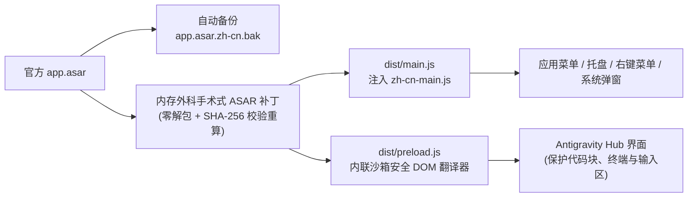

<div align="center">

# Antigravity 简体中文汉化套件 (antigravity-zh-cn)

**零依赖 · 纯源码开源 · 外科手术式 ASAR 注入 · SHA-256 完整校验 · 一键无损还原**

[](https://github.com/contile/antigravity-zh-cn/actions/workflows/ci.yml)
[](https://github.com/contile/antigravity-zh-cn/releases)
[](https://github.com/contile/antigravity-zh-cn/stargazers)
[](LICENSE)
[](package.json)
[](#快速开始)

专为 **Google Antigravity 2.0+ 桌面端** 打造的现代化简体中文本地化工具。<br/>
不依赖任何第三方 npm/pip 包，不分发闭源 `.exe`，**甚至无需提前安装 Node.js 或 Python**——Windows / macOS / Linux 全平台开箱即用。

[快速开始](#快速开始) · [核心特性](#为什么选择本项目) · [实现原理](#实现原理) · [自定义词库](#自定义词库与高级用法) · [常见问题](#常见问题-faq) · [参与贡献](CONTRIBUTING.md)

</div>

---

## 为什么选择本项目

| 维度 | 传统汉化脚本 / 闭源 exe | `antigravity-zh-cn` |
| :--- | :--- | :--- |
| **安全性与透明度** | 闭源打包 exe，难以审计是否夹带私货 | **100% 纯源码**，零第三方依赖，核心逻辑 < 600 行，随时可审计 |
| **环境要求** | 需要手动安装 Node.js / Python / `@electron/asar` | **零环境门槛**：优先使用系统 Node，无 Node 时自动复用 Antigravity 内置 Electron Node 运行时 |
| **打包可靠性** | 解包数千个 `node_modules` 文件再重打包，易丢权限或损坏校验 | **内存外科手术式补丁**：仅修改目标文件并自动重算 SHA-256 块校验，毫秒级完成 |
| **官方更新兼容性** | 更新后旧备份容易覆盖新版，或重复注入导致异常 | **智能版本感知备份**：官方更新后自动刷新原版备份，重复执行 100% 幂等 |
| **界面稳定性** | 全局暴力替换容易破坏代码块、终端日志、React 状态 | **React Fiber 安全原地更新** + 严格白名单源检测 + 代码块/编辑器/终端/输入框全面保护 |
| **菜单功能完整性** | 直接篡改菜单标签容易破坏 `Check for Updates` / `Connect to WSL` | **无损代理菜单钩子**：界面显示中文，回调内部保留原英文键值，原生功能零破坏 |

---

## 快速开始

> ⚠️ 操作前请先退出正在运行的 Antigravity（Windows 一键脚本也支持自动检测并帮你关闭）。

### Windows 用户（推荐：3 秒双击安装）

1. 点击页面右上角 **Code → Download ZIP**（或前往 **Releases** 下载最新压缩包），解压到任意目录；
   或者使用 Git 克隆：
   ```powershell
   git clone https://github.com/contile/antigravity-zh-cn.git
   ```
2. 双击运行根目录下的 **`一键安装中文汉化.bat`**。
3. 重新打开 Antigravity，即可享受完整简体中文界面！

如需还原为官方原版英文，双击 **`一键还原官方英文.bat`** 即可无损恢复（与官方原版文件字节级完全一致）。

---

### macOS / Linux 用户

```bash
git clone https://github.com/contile/antigravity-zh-cn.git
cd antigravity-zh-cn

# 一键安装中文汉化（macOS 会自动尝试本地 ad-hoc 签名以防止闪退）
bash scripts/install.sh

# 如需无损还原为官方英文版
bash scripts/restore.sh
```

---

### 开发者 CLI 用法

如果你已安装 Node.js (>= 18)，也可以直接使用统一 CLI：

```bash
# 安装 / 更新汉化（支持重复运行，自动更新词库）
node bin/cli.js install

# 查看当前 Antigravity 路径、版本与汉化状态
node bin/cli.js status

# 一键无损还原为官方原版
node bin/cli.js restore

# 手动指定自定义安装路径
node bin/cli.js install --target "D:\Apps\Antigravity"

# 校验词库 JSON 与正则合法性 & 运行自动化测试
npm run validate-dict
npm test
```

---

## 实现原理

本项目采用 **Electron 主进程钩子 + 沙箱渲染层动态翻译** 双层架构，通过纯 JavaScript 实现的 ASAR 补丁引擎完成增量注入：



- **主进程层 (`src/runtime/main-hook.js`)**：拦截 `Menu.setApplicationMenu`、`Menu.buildFromTemplate`、`Tray.setContextMenu` 与 `dialog.*`，对显示标签做汉化，并通过 `Proxy` 保留回调函数内的原始英文标签，避免破坏官方更新器与 WSL 菜单逻辑。
- **渲染层 (`src/runtime/preload-hook.js`)**：完全兼容 Electron `sandbox: true` 与 `contextIsolation: true`，仅在本地 Hub 源（`localhost` / `127.0.0.1`）启用，使用 `MutationObserver` + `requestAnimationFrame` 批处理原地更新文本节点，绝不触碰 `<code>`、`<pre>`、`<textarea>`、Monaco 编辑器、终端及外部网页。

---

## 自定义词库与高级用法

### 1. 添加个人专属词条（升级不丢失）

创建 `~/.antigravity-zh-cn/custom.json`（Windows 为 `C:\Users\<用户名>\.antigravity-zh-cn\custom.json`）：

```json
{
  "menu": {
    "Custom Menu Label": "自定义菜单名称"
  },
  "ui": {
    "Some New Feature": "某个新功能"
  },
  "patterns": [
    {
      "regex": "^(\\d+)\\s+items?\\s+selected$",
      "flags": "i",
      "replace": "已选择 $1 项"
    }
  ]
}
```

保存后重新执行一次安装命令，你的自定义词条就会自动合并生效。

### 2. 临时切回英文（免还原）

启动 Antigravity 时传入环境变量 `ANTIGRAVITY_ZH_CN=0` 即可本次临时使用英文原版：

```powershell
# Windows PowerShell
$env:ANTIGRAVITY_ZH_CN="0"; & "$env:LOCALAPPDATA\Programs\antigravity\Antigravity.exe"
```

### 3. 发现未翻译词条（贡献者调试模式）

设置环境变量 `ANTIGRAVITY_ZH_CN_DEBUG=1` 启动 Antigravity，打开开发者工具（DevTools）即可实时查看尚未收录的短界面英文文案，欢迎直接提 PR 补充到 `locales/zh-CN/`！

---

## 常见问题 (FAQ)

<details>
<summary><b>Q1：Antigravity 官方自动更新后变回英文了怎么办？</b></summary>

官方更新会用新版覆盖 `app.asar`。只需退出软件后重新运行一次 **`一键安装中文汉化.bat`**（或 `bash scripts/install.sh`），工具会自动识别这是新版官方文件、刷新原版备份并重新注入汉化。

</details>

<details>
<summary><b>Q2：Windows 双击运行提示无法写入 / EBUSY？</b></summary>

这表示 Antigravity 仍在后台运行（可能最小化在右下角系统托盘中）。请先右键托盘图标选择 `Quit` 完全退出，或直接在一键脚本提示自动关闭时输入 `Y`。

</details>

<details>
<summary><b>Q3：macOS 汉化后打开提示“应用已损坏”或闪退？</b></summary>

Apple Silicon (M1/M2/M3/M4) 对应用包签名校验较严格。`scripts/install.sh` 已内置自动自签名；如遇权限问题，可手动在终端执行：
```bash
codesign --force --deep --sign - "/Applications/Antigravity.app"
```

</details>

<details>
<summary><b>Q4：会影响 AI 的代码生成、对话内容或账号安全吗？</b></summary>

**完全不会。** 本项目不拦截任何网络请求、不读取任何账号凭据、不修改 AI 提示词或输出内容；渲染层翻译严格跳过代码块、终端、编辑器和输入框，仅作用于客户端界面元素。

</details>

---

## 目录结构

```text
antigravity-zh-cn/
├── 一键安装中文汉化.bat       # Windows 零依赖双击安装入口
├── 一键还原官方英文.bat       # Windows 一键无损还原入口
├── bin/cli.js                 # 跨平台统一 CLI
├── src/
│   ├── asar.js                # 纯 JS ASAR 解析 / 增量补丁 / SHA-256 校验引擎
│   ├── locator.js             # Windows / macOS / Linux 自动安装目录探测
│   ├── patcher.js             # 备份、注入、幂等更新与还原核心
│   └── runtime/
│       ├── main-hook.js       # Electron 主进程菜单 / 托盘 / 弹窗汉化
│       └── preload-hook.js    # 沙箱安全 DOM 动态汉化引擎
├── locales/zh-CN/             # 独立维护的中文词库（menu / ui / patterns）
├── scripts/                   # macOS / Linux 安装与还原脚本
└── test/                      # 自动化单元测试与真实 ASAR 集成测试
```

---

## 参与贡献 & 支持项目

如果这个项目帮到了你，欢迎点一颗免费的 **Star ⭐** 让更多中文开发者看到它！

发现漏翻词条、错译或新版本适配需求，欢迎提交 [Issue](../../issues) 或 [Pull Request](CONTRIBUTING.md)。

## 免责声明与开源协议

- 本项目为社区开源中文本地化工具，与 Google 官方无任何隶属关系，不包含也不分发任何官方闭源二进制或受版权保护的资源文件。
- 本项目基于 [MIT License](LICENSE) 开源。
